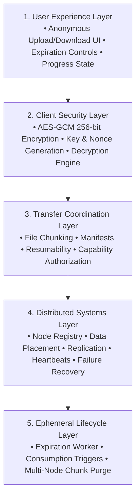
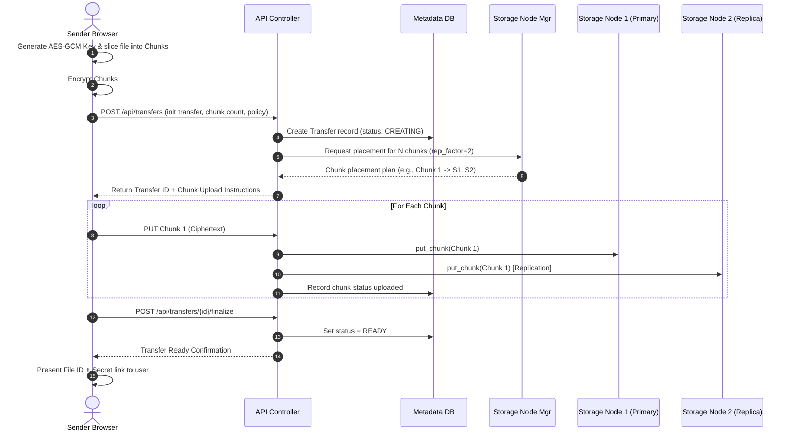
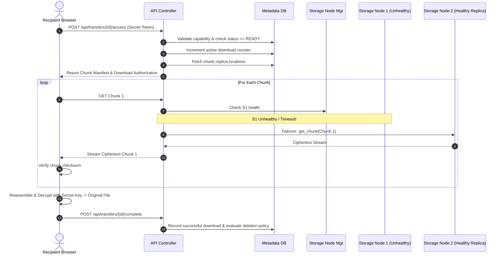

# System Architecture - VoidShare

## 1. Five-Layer System Architecture

The VoidShare architecture is structured across five core layers:



---

## 2. High-Level Component Topology

```
                   ┌────────────────────────────────────────┐
                   │             Browser Client             │
                   │  - File Selection    - AES-GCM Enc/Dec │
                   │  - Secret Handling   - Chunk Slicing   │
                   └───────────────────┬────────────────────┘
                                       │ HTTPS / REST API
                                       ▼
                   ┌────────────────────────────────────────┐
                   │             API Controller             │
                   │  - Transfer Lifecycle Management       │
                   │  - Capability-based Authorization      │
                   │  - Upload/Download Stream Orchestrator │
                   └─────────┬──────────────┬───────────────┘
                             │              │
        ┌────────────────────┴───┐      ┌───┴────────────────────┐
        ▼                        ▼      ▼                        ▼
┌───────────────┐      ┌────────────────────┐      ┌───────────────────┐
│  Metadata DB  │      │ Storage Node Mgr   │      │ Background        │
│  (State, TTL, │      │ - Heartbeat Monitor│      │ Workers           │
│   Manifests)  │      │ - Placement Engine │      │ - Expiration Sweeper
└───────────────┘      │ - Health State     │      │ - Recovery Worker │
                       └─────────┬──────────┘      └───────────────────┘
                                 │
         ┌───────────────────────┼───────────────────────┐
         ▼                       ▼                       ▼
┌──────────────────┐    ┌──────────────────┐    ┌──────────────────┐
│ Storage Node 1   │    │ Storage Node 2   │    │ Storage Node 3   │
│ - Chunk Storage  │    │ - Chunk Storage  │    │ - Chunk Storage  │
│ - Node Health API│    │ - Node Health API│    │ - Node Health API│
└──────────────────┘    └──────────────────┘    └──────────────────┘
```

---

## 3. Subsystem Breakdown & Responsibilities

### 3.1 Client (Browser)
- **Zero-Knowledge Crypto**: Generates ephemeral symmetric encryption keys (AES-GCM 256-bit) and initialization vectors (IVs).
- **Chunk Partitioning**: Slices plaintext files into uniform byte chunks, encrypts them, and computes integrity checksums.
- **Secret Management**: Encodes retrieval secret/password into capability tokens or shareable URLs (anchor hash fragments `#secret` to avoid transmitting secrets in HTTP headers to server).
- **Decryption & Reconstruction**: Fetches encrypted chunks in sequence, verifies checksums, decrypts into local memory/Blob, and triggers client file download.

### 3.2 API / Controller
- **Capability Verification**: Validates whether the supplied File ID and capability token match active database records without leaking file existence to unauthorized requests.
- **Transfer Orchestration**: Manages upload sessions, returns upload manifests, assigns storage nodes for chunks, and routes download stream requests.
- **Decoupled Architecture**: Strictly forwards ciphertext streams; never participates in plaintext processing.

### 3.3 Metadata Database
- **Small-Footprint Coordination**: Stores only file records, chunk ordering, replica node mappings, TTL timestamps, and download counters.
- **Zero Key Storage**: Plaintext file contents and client decryption keys are **strictly forbidden** from database persistence.

### 3.4 Storage Node Manager & Background Workers
- **Heartbeat & Health Monitor**: Collects periodic heartbeats from registered storage nodes; tracks states: `HEALTHY`, `UNHEALTHY`, `UNAVAILABLE`, `RECOVERING`.
- **Placement Engine**: Determines primary and replica node allocations for each chunk (via consistent hashing or capacity weighting).
- **Expiration Worker**: Scans for transfers past their TTL or download threshold, sets status to `DELETING`, and dispatches bulk delete RPCs to storage nodes.
- **Recovery Worker**: Scans for chunks whose replica count falls below the configured replication threshold due to node failures and dispatches re-replication jobs.

### 3.5 Storage Nodes
- **Pluggable Interface**: Exposes a clean, modular storage interface decoupled from underlying storage media:
  - `put_chunk(chunk_id, data_stream)`
  - `get_chunk(chunk_id) -> stream`
  - `delete_chunk(chunk_id)`
  - `has_chunk(chunk_id) -> bool`
  - `health_check() -> status`
- **Isolation**: Each node operates independently, managing its dedicated volume or directory space.

---

## 4. End-to-End Data Flows

### 4.1 Upload & Placement Flow


### 4.2 Retrieval & Failover Flow


---

## 5. Distributed Systems Concepts in VoidShare

| Concept | Problem Solved | Mechanism in VoidShare |
| :--- | :--- | :--- |
| **Data Partitioning (Chunking)** | Large files cannot be uploaded or held in memory as one monolithic block. | Client divides encrypted payload into uniform chunks. |
| **Distributed Placement** | Avoid bottlenecking a single disk and distribute storage across nodes. | Node Manager places chunks across nodes using placement logic (e.g. Consistent Hashing ring). |
| **Replication** | Prevent data loss when individual storage nodes crash or disconnect. | Configurable `replication_factor = N`; chunks stored on primary and replica nodes. |
| **Failure Detection** | Identify offline nodes to stop assigning new work and enable failover. | Storage nodes send periodic heartbeats to Node Manager; timeout flags node unhealthy. |
| **Fault Tolerance & Recovery** | Maintain availability and restore redundancy after node outages. | Coordinator redirects downloads to replica nodes; background recovery worker re-replicates under-replicated chunks. |
| **Concurrency Control** | Prevent race conditions (e.g., simultaneous download and expiration deletion). | Atomic database state transitions (`READY` → `DOWNLOADING` → `CONSUMED` → `DELETING`) and optimistic/pessimistic locking. |
| **Distributed Cleanup** | Reclaim storage and ensure ephemeral guarantees across all replicas. | Expiration worker broadcasts delete RPCs to all replica nodes upon TTL expiry or consumption. |

---

## 6. Local Simulation vs Production Deployment

```
[ Local Development Simulation ]
Host Machine (Localhost)
├── API Server (Port 8080)
├── Metadata DB (SQLite / PostgreSQL)
├── Storage Node 1 (Docker Container / Volume A / Port 9001)
├── Storage Node 2 (Docker Container / Volume B / Port 9002)
└── Storage Node 3 (Docker Container / Volume C / Port 9003)

[ Production Multi-Node Topology ]
                 Internet
                    │
            [ Load Balancer ]
             │             │
      ┌──────▼──────┐ ┌────▼────────┐
      │ API Node 1  │ │ API Node 2  │
      └──────┬──────┘ └────┬────────┘
             │             │
       [ Metadata Cluster / DB ]
             │
      ┌──────┴──────────────────────┐
      ▼                             ▼
[ VPS / Node 1 ]             [ VPS / Node 2 ]             [ VPS / Node 3 ]
(Dedicated Disk)             (Dedicated Disk)             (Dedicated Disk)
```
