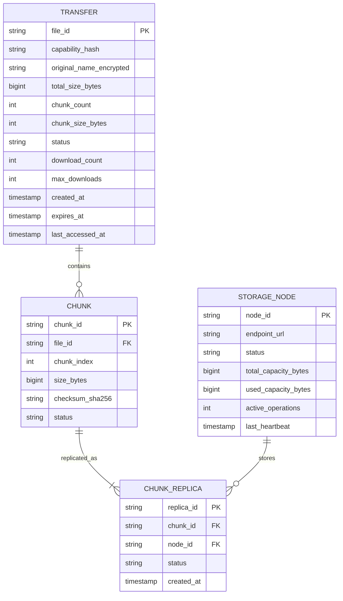

# Database Architecture & Schema - VoidShare

## 1. Database Role & Design Philosophy

The metadata database serves strictly as a **coordination and state management layer**. 
- **Small Footprint**: Stores lightweight metadata (timestamps, state flags, chunk indices, node locations).
- **Zero File Storage**: Actual encrypted chunks reside entirely on decentralized storage nodes.
- **Zero Decryption Keys**: Decryption keys and plaintext are **never** stored in the database.

---

## 2. Entity Relationship Model



---

## 3. Schema Definitions

### 3.1 `transfers` Table
Tracks transfer sessions, expiration policies, and lifecycle state.

| Column | Type | Constraints | Description |
| :--- | :--- | :--- | :--- |
| `file_id` | `VARCHAR(64)` | `PRIMARY KEY` | Cryptographically random unique identifier |
| `capability_hash` | `VARCHAR(128)` | `NOT NULL` | Hash/token of the retrieval capability secret for auth |
| `original_name_encrypted` | `TEXT` | `NULLABLE` | Optional encrypted file name string |
| `total_size_bytes` | `BIGINT` | `NOT NULL` | Total ciphertext size across all chunks |
| `chunk_count` | `INTEGER` | `NOT NULL` | Total number of chunks in file |
| `chunk_size_bytes` | `INTEGER` | `NOT NULL` | Uniform chunk size (e.g., 4194304 bytes) |
| `status` | `VARCHAR(32)` | `NOT NULL` | State: `CREATING`, `UPLOADING`, `READY`, `DOWNLOADING`, `CONSUMED`, `EXPIRED`, `DELETING`, `DELETED`, `FAILED` |
| `download_count` | `INTEGER` | `DEFAULT 0` | Number of successful downloads completed |
| `max_downloads` | `INTEGER` | `DEFAULT 1` | Max allowed downloads before deletion (0 for unlimited until TTL) |
| `created_at` | `TIMESTAMP` | `DEFAULT NOW()` | Record creation timestamp |
| `expires_at` | `TIMESTAMP` | `NOT NULL` | Expiration deadline timestamp |
| `version` | `INTEGER` | `DEFAULT 1` | Optimistic locking version counter |

*Indexes*:
- `idx_transfers_status_expires_at` on `(status, expires_at)` (for fast expiration scanning).

### 3.2 `chunks` Table
Maintains chunk ordering and integrity checksums.

| Column | Type | Constraints | Description |
| :--- | :--- | :--- | :--- |
| `chunk_id` | `VARCHAR(64)` | `PRIMARY KEY` | Unique chunk identifier |
| `file_id` | `VARCHAR(64)` | `FOREIGN KEY (file_id) REFERENCES transfers(file_id) ON DELETE CASCADE` | Parent transfer reference |
| `chunk_index` | `INTEGER` | `NOT NULL` | Zero-indexed chunk sequence position |
| `size_bytes` | `INTEGER` | `NOT NULL` | Byte size of chunk ciphertext |
| `checksum_sha256` | `VARCHAR(64)` | `NOT NULL` | Ciphertext SHA-256 verification hash |
| `status` | `VARCHAR(32)` | `DEFAULT 'PENDING'` | `PENDING`, `STORED`, `DELETED` |

*Indexes*:
- `idx_chunks_file_index` on `(file_id, chunk_index)` `UNIQUE`.

### 3.3 `storage_nodes` Table
Maintains the registry of active physical or virtual storage containers.

| Column | Type | Constraints | Description |
| :--- | :--- | :--- | :--- |
| `node_id` | `VARCHAR(64)` | `PRIMARY KEY` | Unique node identifier (e.g. `node-1`) |
| `endpoint_url` | `VARCHAR(255)` | `NOT NULL` | Network endpoint / internal URI |
| `status` | `VARCHAR(32)` | `NOT NULL` | `HEALTHY`, `UNHEALTHY`, `UNAVAILABLE`, `RECOVERING` |
| `total_capacity_bytes` | `BIGINT` | `DEFAULT 0` | Total storage capacity |
| `used_capacity_bytes` | `BIGINT` | `DEFAULT 0` | Currently utilized storage capacity |
| `active_operations` | `INTEGER` | `DEFAULT 0` | Count of in-flight upload/download operations |
| `last_heartbeat` | `TIMESTAMP` | `NOT NULL` | Last heartbeat received timestamp |

*Indexes*:
- `idx_storage_nodes_status_heartbeat` on `(status, last_heartbeat)`.

### 3.4 `chunk_replicas` Table
Maps which storage nodes hold physical copies of each chunk.

| Column | Type | Constraints | Description |
| :--- | :--- | :--- | :--- |
| `replica_id` | `VARCHAR(64)` | `PRIMARY KEY` | Unique replica mapping identifier |
| `chunk_id` | `VARCHAR(64)` | `FOREIGN KEY (chunk_id) REFERENCES chunks(chunk_id) ON DELETE CASCADE` | Parent chunk reference |
| `node_id` | `VARCHAR(64)` | `FOREIGN KEY (node_id) REFERENCES storage_nodes(node_id)` | Storage node location |
| `status` | `VARCHAR(32)` | `DEFAULT 'ACTIVE'` | `ACTIVE`, `ORPHANED`, `PURGED` |
| `created_at` | `TIMESTAMP` | `DEFAULT NOW()` | Replica creation timestamp |

*Indexes*:
- `idx_replicas_chunk_node` on `(chunk_id, node_id)` `UNIQUE`.
- `idx_replicas_node_status` on `(node_id, status)`.

---

## 4. Atomic Concurrency Operations

To prevent race conditions without excessive locking, state transitions use atomic conditional updates (Compare-And-Swap):

### 4.1 Initiating Download on Single-Use File
```sql
-- Atomically verify file is READY before permitting download
UPDATE transfers 
SET status = 'DOWNLOADING', version = version + 1
WHERE file_id = :fileId 
  AND status = 'READY' 
  AND expires_at > NOW();
```

### 4.2 Completing Download & Consumption
```sql
-- Atomically increment download count and transition to CONSUMED if limit reached
UPDATE transfers
SET download_count = download_count + 1,
    status = CASE 
      WHEN max_downloads > 0 AND (download_count + 1) >= max_downloads THEN 'CONSUMED'
      ELSE 'READY'
    END,
    version = version + 1
WHERE file_id = :fileId AND status = 'DOWNLOADING';
```

### 4.3 Expiration Sweeper Lock
```sql
-- Fetch and atomically lock expired transfers for deletion
UPDATE transfers
SET status = 'DELETING', version = version + 1
WHERE status IN ('READY', 'CONSUMED', 'FAILED') 
  AND (expires_at <= NOW() OR status = 'CONSUMED')
RETURNING file_id;
```
