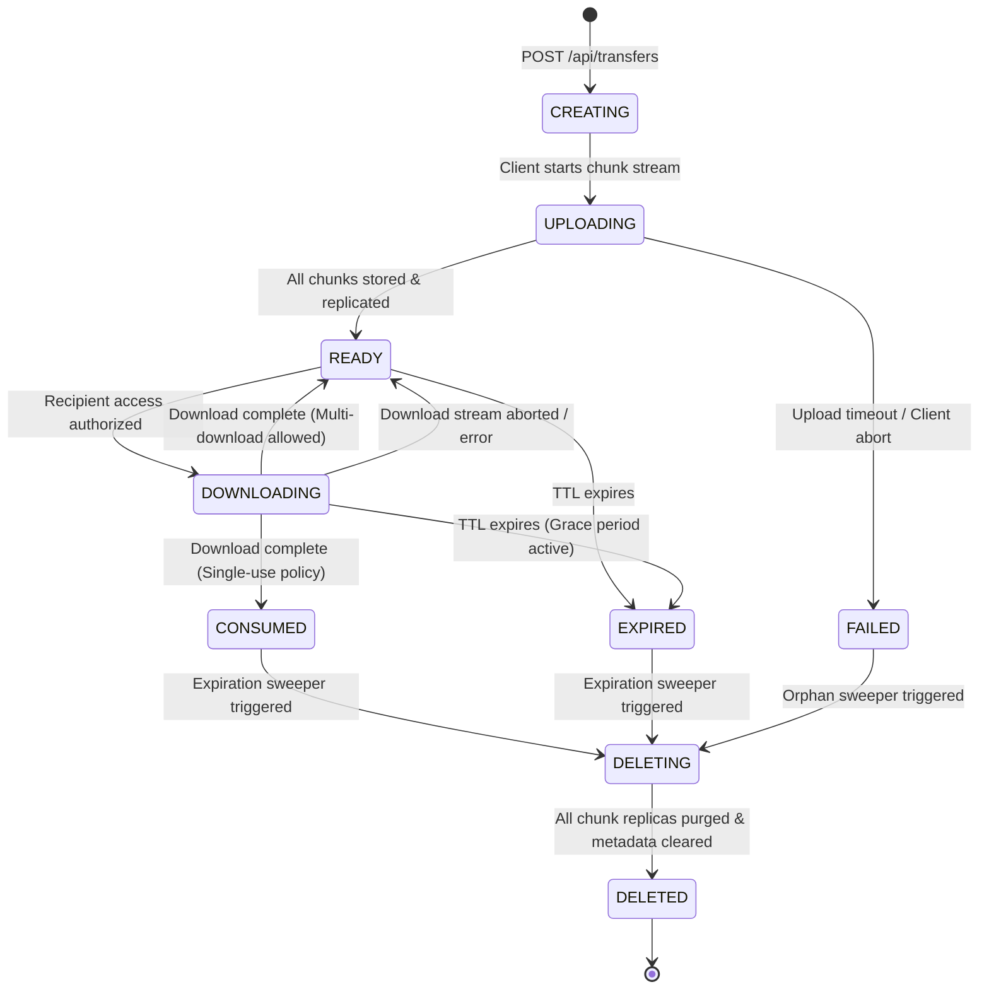

# Transfer Lifecycle & Concurrency Control - VoidShare

## 1. Transfer State Machine

Every transfer session progresses through explicit, deterministic lifecycle states:

---

## 2. Detailed Lifecycle Stages

### 2.1 Creation & Upload Stage
1. **`CREATING`**: Client initializes session with chunk count, total ciphertext size, and expiration policy.
2. **`UPLOADING`**: Client streams encrypted chunks. Chunks are committed to primary and replica storage nodes.
3. **`READY`**: All chunks are acknowledged with verified checksums. The transfer is now available for retrieval.

### 2.2 Download & Consumption Stage
1. **`DOWNLOADING`**: Recipient presents valid capability token. Server locks transfer status or increments active download counter.
2. **`CONSUMED`**: If `max_downloads = 1` (default single-use mode), successful download completion transitions status to `CONSUMED`. Subsequent access attempts are blocked.

### 2.3 Expiration & Deletion Stage
1. **`EXPIRED`**: Current timestamp exceeds `expires_at`. Immediate blocking of new download requests.
2. **`DELETING`**: Background Expiration Worker dispatches parallel `delete_chunk` commands across all storage nodes holding replicas.
3. **`DELETED`**: All chunk deletions are acknowledged; metadata database record is updated or purged; physical storage space is fully reclaimed.

---

## 3. Concurrency Race Conditions & Solutions

### 3.1 Race Scenario 1: Simultaneous Download and Expiration Sweeper
- **Problem**: File reaches TTL at `10:00:00`. At `10:00:00`, recipient requests download while Expiration Worker attempts deletion.
- **Solution**: 
  - Compare-And-Swap (CAS) state check: Expiration Worker attempts to set status `READY → DELETING`.
  - If a download is already in progress (`status == DOWNLOADING`), the Expiration Worker delays deletion until active chunk streams complete or a 60-second grace timeout expires.
  - If the Expiration Worker wins the CAS update (`status == DELETING`), the download request is rejected with `410 Gone / Transfer Expired`.

### 3.2 Race Scenario 2: Two Simultaneous Downloads on "Delete-After-First-Download"
- **Problem**: Two recipients attempt to download a single-use transfer concurrently.
- **Solution**:
  - Database enforces an atomic increment on `download_count`.
  - When the first client completes chunk verification and submits `POST /api/transfers/:fileId/complete`, status transitions atomically to `CONSUMED`.
  - Any subsequent or parallel download session attempting to finalize receives a `410 Gone` notification.

### 3.3 Race Scenario 3: Replication During Expiration Deletion
- **Problem**: The Recovery Worker is copying a chunk to restore redundancy at the exact moment the Expiration Worker triggers deletion.
- **Solution**:
  - Replication jobs check the transfer state in the database before committing the newly copied chunk.
  - If transfer status is `DELETING` or `EXPIRED`, the replication job aborts and deletes any temporary chunk buffer created during the transfer.

### 3.4 Race Scenario 4: Node Failure During Expiration Deletion
- **Problem**: A storage node containing a chunk replica is offline when the Expiration Worker attempts to delete chunks.
- **Solution**:
  - The Expiration Worker purges all reachable replica nodes and marks the chunk replica record as `ORPHANED_PENDING_DELETE`.
  - When the failed node reconnects and sends a heartbeat in `RECOVERING` status, the coordinator dispatches a reconciliation command to purge all pending deleted chunks before marking the node `HEALTHY`.
