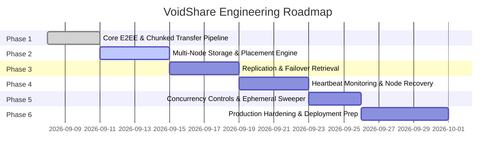

# Project Roadmap & Milestones - VoidShare

## 1. Development Principles & Priorities

When prioritizing features and architectural changes, development follows this strict order of precedence (Section 76):
1. **Priority 1 — Correctness**: File uploads, chunks, downloads, and client decryption must work reliably.
2. **Priority 2 — Security**: Zero-knowledge E2EE guarantees; keys and plaintexts never touch server infrastructure.
3. **Priority 3 — Ephemeral Lifecycle**: Robust auto-deletion by TTL and download consumption.
4. **Priority 4 — Distributed Correctness**: Accurate chunk metadata and replica synchronization across nodes.
5. **Priority 5 — Fault Tolerance**: Graceful failover to replicas when storage nodes go offline.
6. **Priority 6 — Scalability**: Modular separation allowing independent scaling of API and storage nodes.
7. **Priority 7 — Performance**: Parallel streaming and efficient storage I/O.
8. **Priority 8 — UI Polish**: Intuitive, minimalist user experience.

---

## 2. Phased Implementation Milestones

### Phase 1: Core E2EE & Chunked Transfer Pipeline
- [x] Establish master project documentation and architectural specifications.
- [ ] Inspect existing frontend and backend implementations to map existing capabilities.
- [ ] Implement/verify client-side Web Crypto AES-256-GCM encryption and decryption.
- [ ] Implement client-side file chunking and binary stream upload/download pipelines.
- [ ] Verify basic end-to-end flow: Upload file → receive secret link → download → verify decrypted file integrity.

### Phase 2: Multi-Node Storage & Placement Engine
- [ ] Implement decoupled Storage Node interface (`putChunk`, `getChunk`, `deleteChunk`, `hasChunk`, `healthCheck`).
- [ ] Create Docker Compose / multi-directory simulation setup for 3 local storage nodes.
- [ ] Build Placement Engine to distribute encrypted chunks across nodes (consistent hashing / round-robin).
- [ ] Update Metadata DB to track chunk-to-node placement manifests.

### Phase 3: Replication & Failover Retrieval
- [ ] Implement configurable `replication_factor` (e.g. $N=2$) during chunk upload.
- [ ] Implement coordinator failover logic: if primary node fails, retrieve chunk from active replica.
- [ ] Add unit and integration tests verifying successful file downloads with 1 storage node disabled.

### Phase 4: Node Health Monitoring & Automated Recovery
- [ ] Implement periodic heartbeat protocol (10s interval) between storage nodes and Node Manager.
- [ ] Implement node state transitions (`HEALTHY`, `UNHEALTHY`, `UNAVAILABLE`, `RECOVERING`).
- [ ] Build background Recovery Worker to detect under-replicated chunks and trigger re-replication to healthy nodes.

### Phase 5: Concurrency Control & Ephemeral Lifecycle
- [ ] Implement atomic state machine transitions (`CREATING` → `READY` → `DOWNLOADING` → `CONSUMED` → `DELETING` → `DELETED`).
- [ ] Build Expiration Worker to periodically sweep expired transfers and execute multi-replica chunk deletion.
- [ ] Implement race-condition coordination (simultaneous download vs expiration, delete-after-first-download atomic locking).
- [ ] Implement orphan chunk collector to clean up incomplete or abandoned upload sessions.

### Phase 6: Production Hardening, Observability & Multi-Machine Deployment
- [ ] Implement structured operational logging adhering to zero-knowledge privacy rules.
- [ ] Add API rate limiting and brute-force protection against File ID enumeration.
- [ ] Configure production deployment topology (Nginx/Traefik load balancing, multi-VPS storage node configuration).
- [ ] Perform comprehensive stress and failure injection testing.
